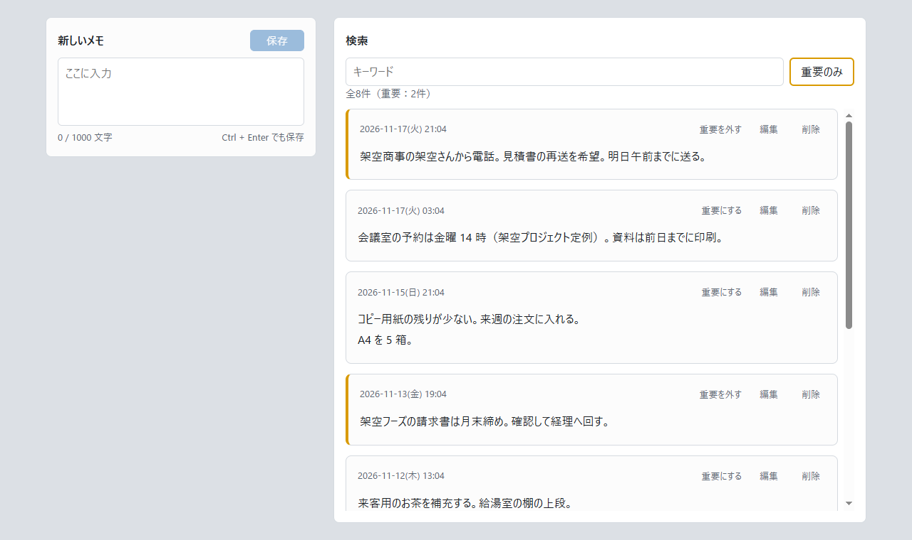
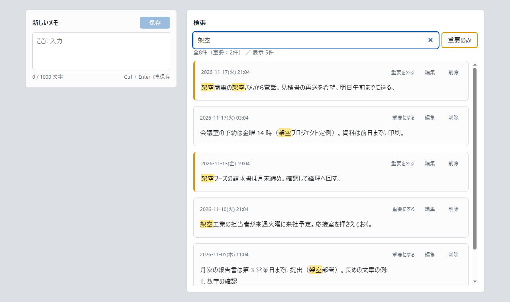
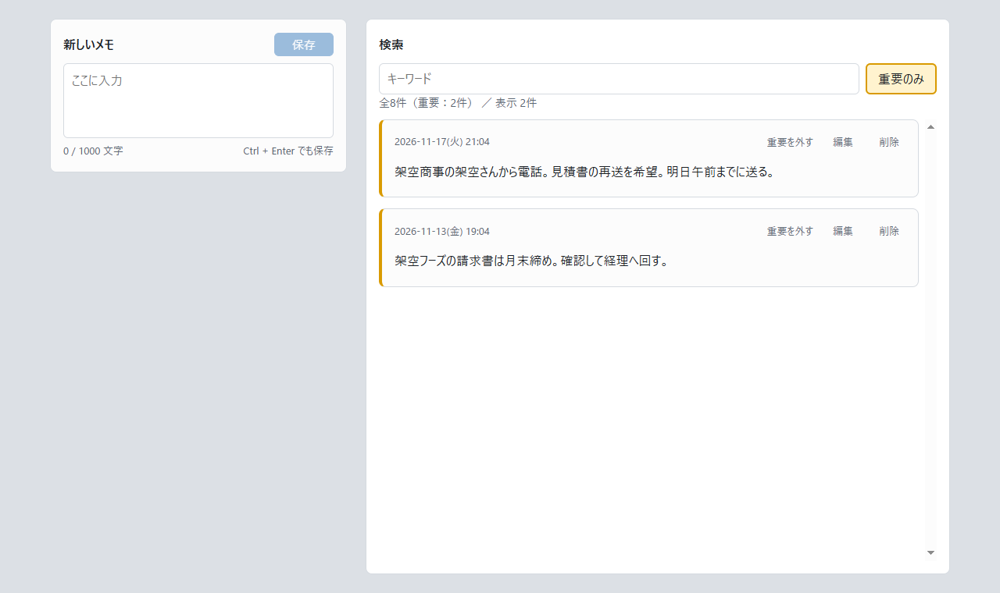
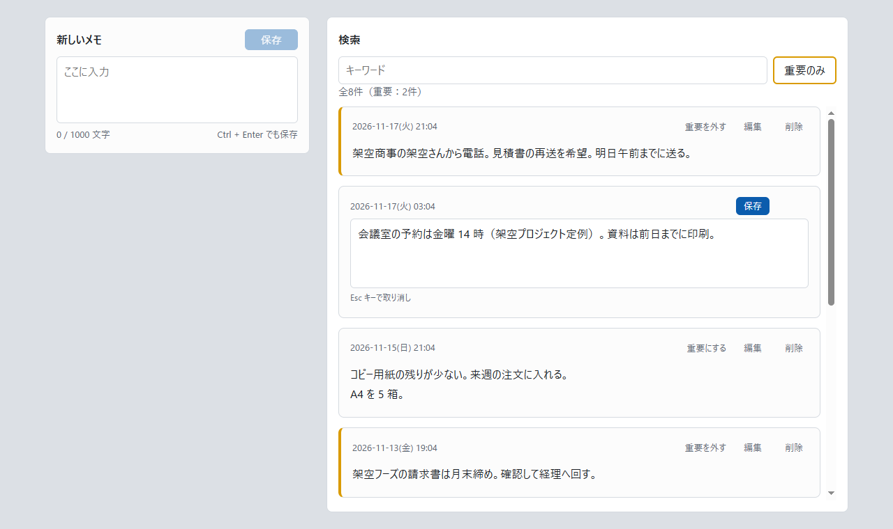
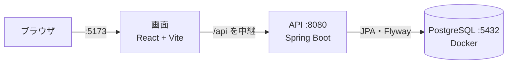

# メモアプリ

[](https://github.com/shijirou/app-practice-002-memo/actions/workflows/ci.yml)

パソコンのブラウザで使う、1 人用のシンプルなメモアプリ。書く・探す・直す・消す・「重要」の印を付ける、を 1 画面でできます。
**AI（Claude Code）と一緒に、要件定義から公開前の安全確認まで通しで進めた練習用アプリ**で、ポートフォリオの一部です。
架空のオフィスサポート会社（株式会社架空オフィスサポート）を想定した、架空の依頼がもとです。



## 画面
| キーワード検索（一致した文字を黄色に） | 「重要のみ」の絞り込み（金色の線が重要） |
|---|---|
|  |  |

その場で編集（Esc で取り消し）。画像の中身は、すべて架空のサンプルです。



## 機能
| # | 機能 | ポイント |
|---|---|---|
| F1 | 登録 | 開いた直後から入力欄にカーソル。Ctrl+Enter でも保存（3 操作以内） |
| F2 | 一覧 | 新しい順。日時は日本時間・曜日つき。長い本文は 3 行まで、押すと全文 |
| F3 | 検索 | 入力するたびに絞り込む。`%` や `_` も普通の文字として探す |
| F4 | 編集 | カードの中で直す。書きかけは、一覧が読み直されても消えない。日本語の変換中の Esc は取り消しにならない |
| F5 | 削除 | 確認メッセージのあとで消す（元に戻せない） |
| F6 | 重要 | 印の付け外しと、「重要のみ」の絞り込み（検索と組み合わせられる） |

## 技術と構成

| 層 | 使っているもの |
|---|---|
| 画面 | React 19・Vite 8・Vitest・oxlint |
| API | Spring Boot 4（Java 25）・Spring Data JPA・Flyway・Testcontainers |
| DB | PostgreSQL 18（Docker） |
| CI | GitHub Actions（画面の lint・テスト・ビルド、API のテスト） |

バージョンの一覧は [技術スタック](docs/tech-stack.md)。API は `GET /api/memos?keyword=&important=`・`GET /api/memos/counts`・`POST /api/memos`・`PUT /api/memos/{id}`・`DELETE /api/memos/{id}`・`PUT /api/memos/{id}/important`（詳しくは [データ設計](docs/data-design.md)）。

## 動かし方
必要なもの: Docker、Java 25、Node.js 24。ポートは固定（画面 5173・API 8080・DB 5432）。API と DB は、自分のパソコンの中（`127.0.0.1`）からだけつながります。
1. `.env.example` をコピーして、リポジトリ直下に `.env` を作り、`DB_PASSWORD` を自分で決める（`.env` は GitHub に載りません）
2. `frontend/` で `npm install`
3. 3 つのターミナルで起動する（ブラウザで http://localhost:5173 を開く）
```
docker compose up -d       # DB（リポジトリ直下）
./gradlew bootRun          # API（backend/ で）
npm run dev                # 画面（frontend/ で）
```
止めるときは、画面と API は `Ctrl + C`、DB は `docker compose down`（メモは残る）。テストは、`backend/` で `./gradlew test`（本物の PostgreSQL を Docker で起動）、`frontend/` で `npm test`・`npm run lint`、`e2e/` で `npm test`（E2E。DB を起動し、画面と API は止めておく。専用の DB を使うので、普段のメモは変わらない）。

## 品質への取り組み
- **テスト 102 件**（API 38・画面 51・E2E 13）。E2E は、画面・API・DB をつないで、実際のブラウザを自動で動かす。網羅率（テストがコードのどれだけを実行したか）は、行で API 93%・画面 99%。CI が毎回測って表に出す。API のテストは、使い捨ての本物の PostgreSQL で動かす。PR のたびに CI が自動で動き、成功しないとマージできない（ルールセットで必須）
- **コードレビュー**を、機能ごとに行った（見つけた指摘・直したこと・見送った理由を記録）。**品質チェック**を 3 回行い、実際に動かして確かめることで、「API が外部からつながる設定だった」などの問題も見つけて直した → [品質チェックの記録](docs/quality-review.md)
- **公開前の安全確認**: 履歴全体の秘密情報検索、個人情報、部品の脆弱性（0 件）、GitHub の設定を確認 → [最終確認](docs/final-check.md)
- 日本語の入力（変換中のキー）、保存・取り消しのキー操作、保存中や通信失敗時の画面の状態、キーボードだけの通し操作（編集・保存・削除）まで、テストで守っている

## 作り方（AI と一緒に進めた工程）
1. 依頼の整理 → [クライアント情報](docs/client-brief.md)・[ペルソナ](docs/persona.md)・[要件定義](docs/requirements.md)・[画面デザイン](docs/screen-design.md)（動く[画面モック](docs/mock/index.html)つき）・[データ設計](docs/data-design.md)
2. 縦に切って、少しずつ作る（登録・一覧 → 検索・重要 → 編集・削除）。各回で、API・画面・テスト・動作確認・コードレビューまで行う
3. すべての変更は **Issue → ブランチ → PR → CI → マージ** の流れで進め、`main` への直接のプッシュは、フックとルールセットで止めている（ルールは [CLAUDE.md](CLAUDE.md)）
4. 作りながらの記録は [進捗状況と再開メモ](docs/progress.md)。コードの読み方は [コードの読み方ガイド](docs/reading-guide.md)

## 注意
公開リポジトリのため、**本物の顧客情報・個人情報は入れていません**。サンプルの人名・会社名・メモの内容は、すべて架空です。
