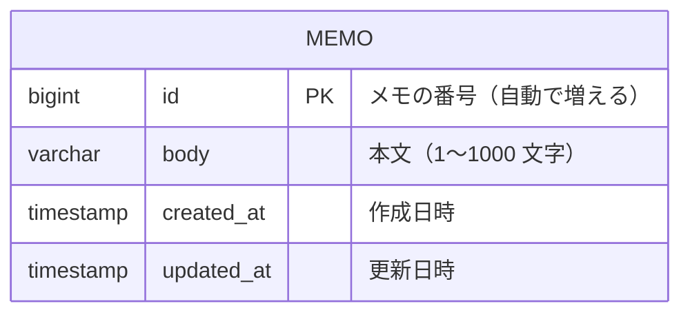

# データ設計（ER 図）

[要件定義書](requirements.md) の「データ」の詳細。

保存するのは「メモ」1 種類だけ。ログインがなく利用者は 1 人なので、ユーザーの箱はなく、ほかの箱との線（関係）もない。

## ER 図


GitHub 上では上の図が表示される。表示されない場合は、次の図で見る。

```
┌──────────────── MEMO（メモ）────────────────┐
│ id          メモの番号   自動で増える（主キー）   │
│ body        本文        1〜1000 文字           │
│ created_at  作成日時    保存したとき            │
│ updated_at  更新日時    保存・編集したとき       │
└─────────────────────────────────────────┘
```

## 項目の決まり
| 項目 | 型 | 必須 | 決まり |
|---|---|---|---|
| id | 整数 | ○ | DB が自動で付ける。変えない |
| body | 文字 | ○ | 前後の空白を除いて 1〜1000 文字。空は不可 |
| created_at | 日時 | ○ | 登録時にサーバーが入れる。一覧の並び順に使う（新しい順） |
| updated_at | 日時 | ○ | 登録時は created_at と同じ。編集のたびに更新 |

- 検索は、body を部分一致（大文字小文字を区別しない）で探す。件数が少ないので、特別な索引は付けない。

## API（画面と DB の間の窓口）
| やりたいこと | 方法と宛先 | 送るもの | 返るもの |
|---|---|---|---|
| 一覧・検索（F2・F3） | GET /api/memos?keyword=〜 | keyword（省略で全件） | メモの配列（新しい順） |
| 登録（F1） | POST /api/memos | body | 作ったメモ |
| 編集（F4） | PUT /api/memos/{id} | body | 直したメモ |
| 削除（F5） | DELETE /api/memos/{id} | なし | なし |

- 入力の検証（空・1000 文字超）は、画面と API の両方で行う。
- DB への問い合わせは、文字を直接つなげず、パラメータで渡す（SQL インジェクション対策）。

## 今回は持たないデータ
タイトル・タグ・ユーザー・削除済みフラグは持たない（[要件定義書](requirements.md) の「対象外」を参照）。

## サンプルデータ（架空）
テストや動作確認では、次のような架空のメモだけを使う。
- 「架空商事の架空さんから電話。見積書の再送を希望。明日午前まで」
- 「会議室の予約は金曜 14 時（架空プロジェクト定例）」
