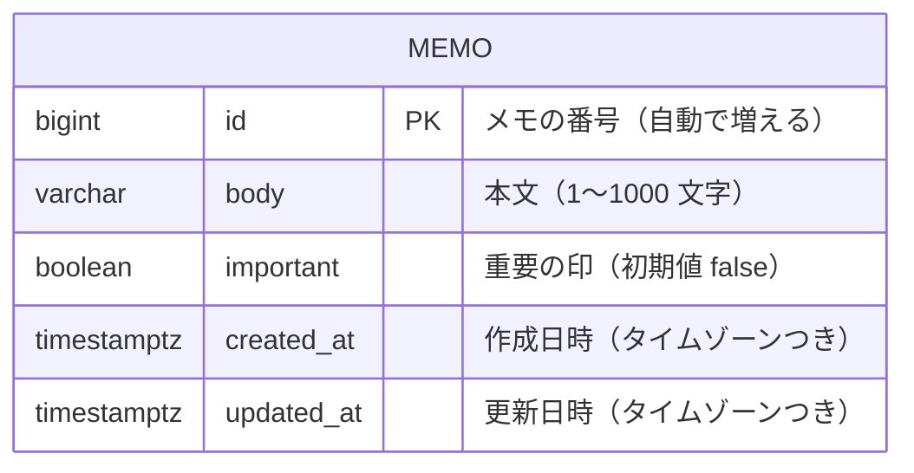

# データ設計（ER 図）

[要件定義書](requirements.md) の「データ」の詳細。

保存するのは「メモ」1 種類だけ。ログインがなく利用者は 1 人なので、ユーザーの箱はなく、ほかの箱との線（関係）もない。

## ER 図


GitHub 上では上の図が表示される。表示されない場合は、次の図で見る。

```
┌──────────────── MEMO（メモ）────────────────┐
│ id          メモの番号   自動で増える（主キー）   │
│ body        本文        1〜1000 文字           │
│ important   重要の印    true / false（初期 false）│
│ created_at  作成日時    保存したとき            │
│ updated_at  更新日時    保存・編集したとき       │
└─────────────────────────────────────────┘
```

## 項目の決まり
| 項目 | 型 | 必須 | 決まり |
|---|---|---|---|
| id | 整数 | ○ | DB が自動で付ける。変えない |
| body | 文字 | ○ | 前後の空白を除いて 1〜1000 文字。空は不可。「文字数」は見た目の 1 文字を 1 と数える（絵文字も 1。Java では `codePointCount` を使う） |
| important | 真偽 | ○ | 登録時は false。「重要にする／重要を外す」で切り替える。並び順には使わない |
| created_at | 日時 | ○ | 登録時にサーバーが入れる。一覧の並び順に使う（新しい順）。画面には曜日をつけて出す |
| updated_at | 日時 | ○ | 登録時は created_at と同じ。本文を編集するたびに更新（重要の付け外しでは変えない） |

- 検索は、body を部分一致（大文字小文字を区別しない）で探す。件数が少ないので、特別な索引は付けない。
- 検索のキーワードに `%` や `_` が含まれていても、記号ではなく普通の文字として探す（SQL の LIKE の記号をエスケープする）。
- キーワードの前後の空白は無視する。空・空白だけなら、キーワードなし（全件）として扱う。
- 「重要のみ」は `important=true` のときだけ絞り込む。`important=false` は絞り込まない（重要でないものだけ、にはならない）。
- 件数（`/counts`）は、絞り込みに関係なく全体の数を返す。画面は「全 n 件（重要：m 件）」に使い、絞り込み中は一覧の件数を「／ 表示 n 件」として足す。
- 日時はタイムゾーンつきで保存し、画面には日本時間（Asia/Tokyo）で出す。

## API（画面と DB の間の窓口）
| やりたいこと | 方法と宛先 | 送るもの | 返るもの |
|---|---|---|---|
| 一覧・検索・重要のみ（F2・F3・F6） | GET /api/memos?keyword=〜&important=true | keyword・important（どちらも省略可。省略で全件） | メモの配列（新しい順） |
| 件数（F2） | GET /api/memos/counts | なし | 全件数と重要の件数 |
| 登録（F1） | POST /api/memos | body | 作ったメモ |
| 編集（F4） | PUT /api/memos/{id} | body | 直したメモ |
| 重要の切り替え（F6） | PUT /api/memos/{id}/important | important | 直したメモ |
| 削除（F5） | DELETE /api/memos/{id} | なし | なし |

- 編集と重要の切り替えは別の窓口にする。本文を編集している途中で重要を切り替えても、古い本文で上書きしないため。
- 入力の検証（空・1000 文字超）は、画面と API の両方で行う。

### 失敗したときの返し方
どの API も、失敗は同じ形で返す。

| 状況 | 状態コード | 返す中身（JSON） |
|---|---|---|
| 入力が正しくない（空・1000 文字超・本文が文字でない（数字・true など）・important が真偽でない・壊れた JSON・id が数字でない） | 400 | `{"message": "本文は 1〜1000 文字で入力してください"}` のように、原因が分かる 1 文 |
| 指定した id のメモがない（編集・重要の切り替え・削除） | 404 | `{"message": "メモが見つかりません"}` |
| 使えない操作（405）・返せない形式（406）・大きすぎる内容（413）・送る形式（Content-Type）が違う（415） | 405・406・413・415 | `{"message": "..."}`。原因が分かる 1 文（例: 「送る形式（Content-Type）が正しくありません。JSON で送ってください」） |
| 想定外のエラー | 500 | `{"message": "エラーが起きました"}`（内部の詳細は返さない） |

- 成功の状態コードは、一覧・件数・編集・重要の切り替えが 200、登録が 201、削除が 204。
- 画面は、失敗したときにメッセージを表示し、入力した文章を消さない。
- DB への問い合わせは、文字を直接つなげず、パラメータで渡す（SQL インジェクション対策）。

## 今回は持たないデータ
タイトル・タグ・カテゴリ・ユーザー・削除済みフラグは持たない（「重要」は印が 1 種類だけの単純な項目）（[要件定義書](requirements.md) の「対象外」を参照）。

## サンプルデータ（架空）
テストや動作確認では、次のような架空のメモだけを使う。
- 「架空商事の架空さんから電話。見積書の再送を希望。明日午前まで」
- 「会議室の予約は金曜 14 時（架空プロジェクト定例）」
